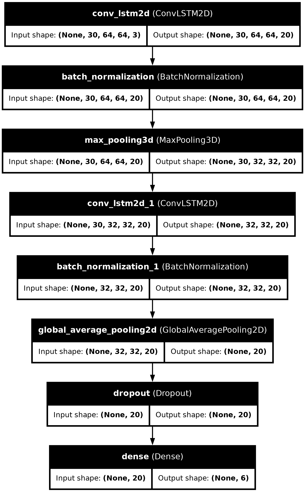
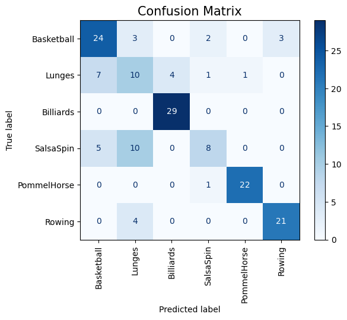
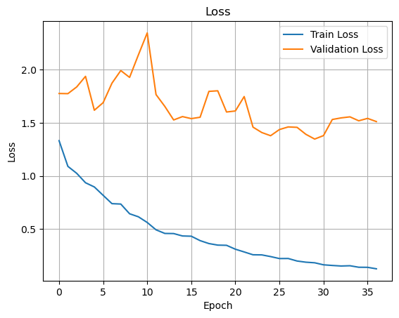
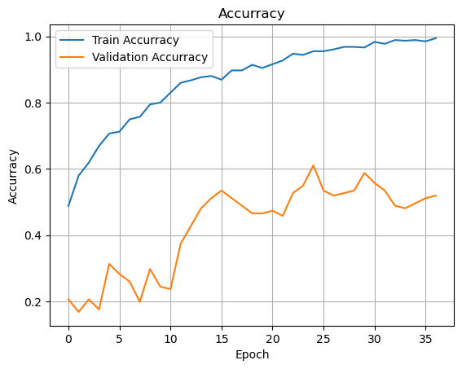
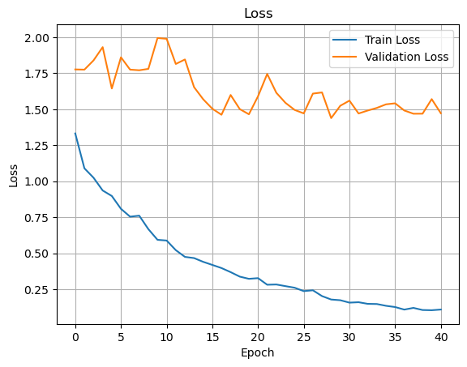
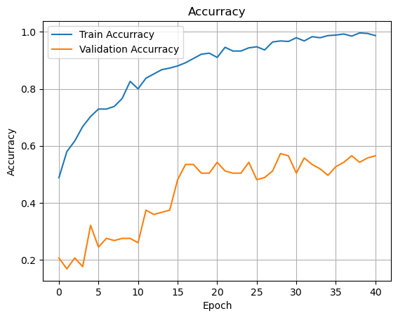

# About this project

Classes: Basketball, Lunges, Billiards, SalsaSpin, PommelHorse, Rowing
Input: 30 frames per video at 64x64 pixels. Model: 

# Problems with first version
First version of the model split the data with train_test_split into train and test sets only. There was no separate validation set, so the test set was also used as validation data. The results were way too good (89% accuracy on 6 classes). 

Also, some clips are taken from original longer videos, so they should stay together in same group. train_test_split has a probability of putting same source group (g01_01, g01_02) in both train and test sets. So, same person and background can end up in two different sets, and model will then rely more on background, than action.

Report for first version is in 'AI Final Project Dmytro Shapovalov.pdf'. Code for first version is in "AI_Final_Project_Dmytro_Shapovalov_Original_Split.ipynb"

This README works as Report for "Group Split" model. Code for second version is in "AI_Final_Project_Dmytro_Shapovalov_Group_Split.ipynb"

# Solution for first version (second version of model)
In second version, I divided data another way. This time I got pure train, test and validation datasets by splitting original videos based on groups. I split 16 group  for training, 4 groups for validation and 5 groups for testing. This is group-based split.

This lead to more truthful results; with basic ConvLSTM2D model and 5 minutes of training I managed to get up to about 73% of test accuracy on two different runs. First run gave 73% accuracy and second run gave 73% accuracy. Training accuracy reaches 99% with validation staying at best at 57% validation accuracy. This means, that model overfits (memorizes) training datasets.

One time I managed to get 77% of test accuracy, but it came from accidentally training the same model twice, so I don't count it.

# Results of second version
Classification report:
                precision    recall  f1-score   support

  Basketball       0.67      0.75      0.71        32
      Lunges       0.37      0.43      0.40        23
   Billiards       0.88      1.00      0.94        29
   SalsaSpin       0.67      0.35      0.46        23
 PommelHorse       0.96      0.96      0.96        23
      Rowing       0.88      0.84      0.86        25

    accuracy                           0.74       155
   macro avg       0.74      0.72      0.72       155
weighted avg       0.74      0.74      0.73       155

From classification report, we can see that model predicts very well Billiards with recall 1 and precision 0.88 and F1 0.94. Model classified well PommelHorse and Rowing - recall 0.96 and 0.84, precision 0.96 and 0.88 and F1 0.96 and 0.86. 

Hardest class to predict for model is SalsaSpin - it's recall is lowest (0.35): only 8 out of 23 videos are found. Other videos are classified as Lunges or Basketball.

Confusion Matrix of classifications:

# Loss of the model:

# Accuracy of the model:

# First run's Loss:

# First runs' accuracy: 

# Limitations
The dataset is small, frames are only 64x64 and model is small. This probably limits test accuracy; model relies more on environment than on motion.

# How to run

For this to work, you need: 

1. Download dataset from Kaggle:

https://www.kaggle.com/datasets/pypiahmad/realistic-action-recognition-ucf50

2. Put a ZIP file to the root of Final_Project folder.

3. Run the Final_Project_Dmytro_Shapovalov_Group_Split.ipynb file.